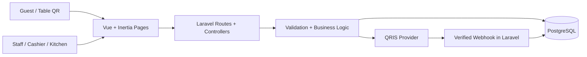

# ARCHITECTURE — Café POS V1

> **Tujuan:** Cara implementasi V1 secara sederhana. **Requirements** ada di `PRD.md`, tabel & constraints di `DATABASE.md`.  
> **Prinsip:** satu aplikasi Laravel, bukan microservices. Teknologi baru ditambahkan hanya kalau ada kebutuhan nyata.

## 1. Stack

| Bagian   | Teknologi                                                      | Alasan                                                             |
| -------- | -------------------------------------------------------------- | ------------------------------------------------------------------ |
| Backend  | **Laravel (PHP)**                                              | Routes, validation, Eloquent, transactions, policies, testing      |
| Frontend | **Vue 3 + Inertia.js**                                         | UI dinamis tanpa membuat frontend API terpisah                     |
| Database | **PostgreSQL**                                                 | Relational FK, transactions, row locking, numeric stock quantities |
| Build    | Vite                                                           | Aset Vue/CSS                                                       |
| Auth     | Laravel session auth (ditambahkan setelah Inventory)           | Staff login sederhana                                              |
| QRIS     | Provider QRIS dinamis (belum dipilih), sandbox/mock saat lokal | Pembayaran hanya dipercaya setelah verifikasi server               |

Gunakan project Laravel/Vue yang sudah berjalan. **Tidak wajib mengganti atau menginstal ulang starter kit**. Jika project dibuat tanpa starter auth, tambahkan login/session sederhana pada tahap Authentication.

## 2. High-level architecture



Aplikasi merupakan **modular monolith**: folder biasa Laravel dengan pemisahan fungsional; tidak perlu membuat package/module framework khusus.

## 3. Tanggung jawab kode

| Layer                    | Tanggung jawab                                                                                 | Jangan lakukan                                                 |
| ------------------------ | ---------------------------------------------------------------------------------------------- | -------------------------------------------------------------- |
| **Vue/Inertia Page**     | Form, validasi UX, tampilan harga/status dari server                                           | Menentukan harga resmi, menandai payment paid                  |
| **Routes + Controllers** | HTTP request, auth, panggil validation/business action, Inertia response                       | Menyimpan seluruh business logic kompleks di controller        |
| **Form Requests**        | Validasi request & pilihan input                                                               | Percaya harga atau stok dari browser                           |
| **Models/Eloquent**      | Relasi, query yang mudah dibaca                                                                | Menaruh seluruh checkout/payment workflow pada model observer  |
| **Services/Actions**     | Hanya untuk alur multi-record: checkout, stok, receiving, payment callback, kitchen transition | Membuat generic repository/CQRS/event sourcing tanpa kebutuhan |
| **PostgreSQL**           | FK, unique constraints, transactions, row locks, saldo konsisten                               | Menyimpan data historis yang bisa berubah tanpa snapshot       |

Nama file/service fleksibel; yang wajib adalah **pemisahan tanggung jawabnya**, bukan menambah layer demi layer.

## 4. Struktur proyek contoh

```text
app/
  Http/Controllers/         # Menu, Inventory, Purchase, POS, Kitchen, QR
  Http/Requests/            # Validasi aksi penting
  Models/                   # Eloquent models
  Services/                 # Hanya proses multi-record yang kompleks
  Policies/                 # Akses fixed roles (saat tahap RBAC)
resources/js/
  Pages/                    # Menu, Inventory, Purchases, POS, Kitchen, Guest
  Components/               # Dipisah hanya jika benar-benar reusable
routes/
  web.php                   # Staff route + guest pages
  # webhook boleh di route terpisah bila perlu pengecualian CSRF yang aman
database/migrations/
database/seeders/
tests/Feature/
PRD.md  DATABASE.md  ARCHITECTURE.md  TASKS.md  AGENTS.md
```

Jangan membuat frontend/backend dua repository terpisah untuk V1.

## 5. Alur request kritis

### A. Menu, resep & harga

- `Controller` → `FormRequest` → Eloquent (CRUD sederhana).
- Saat checkout, Laravel membaca variant dan option yang **aktif**, mengecek assignment, lalu menghitung total menggunakan integer IDR.
- Resep dihitung dari `recipe_items` + `option_ingredients`. V1 additive only. Untuk pastry, baca `product_variants.stock_item_id` dan gunakan `pcs`.

### B. Cashier POS

- Aksi kasir membuat order + snapshots + **stock reservations** setelah validasi stok.
- Untuk cash, pencatatan `paid` dan perpindahan ke `queued` dilakukan sebagai bagian dari transaksi yang konsisten.
- Untuk QRIS di kasir, gunakan sistem provider yang sama dengan Table QR; implementasinya setelah modul pembayaran QRIS siap.

### C. Table QR & QRIS

**Irisan awal yang tersedia:** hanya UI admin untuk pengelolaan meja oleh owner serta pratinjau/unduh SVG/cetak QR. UI pelanggan dikerjakan pengguna secara terpisah; belum ada katalog atau gambar produk publik. QR dibuat lokal saat diminta owner menggunakan `bacon/bacon-qr-code` 3.1.1; link dibentuk dari `APP_URL` dan ID meja. Tidak ada occupancy, reservasi meja, atau token meja. Gunakan route ID meja sesuai PRD terbaru meskipun contoh route lama masih ada di panduan UI/UX.

1. `/menu?table={id}` disiapkan sebagai tujuan QR dan memvalidasi ID meja aktif. Sementara UI pelanggan belum dibuat, respons hanya teks HTTP 503 yang menyatakan menu belum tersedia; ID invalid/meja nonaktif mendapat teks HTTP 404. Tidak ada UI pelanggan atau data katalog yang disajikan. Pada tahap guest berikutnya, route ini akan menampilkan menu dan label meja sesuai PRD.
2. Checkout memvalidasi menu, membuat order `awaiting_payment`, mengunci stok dan menyimpan reservasi serta `checkout_key` (idempotent).
3. Backend meminta QRIS dinamis via provider. Jangan menahan DB transaction terbuka selama network call provider.
4. Webhook provider → verifikasi signature/reference/amount/currency → lock payment + order → tandai paid/queued **sekali**.
5. Callback palsu, duplikat, gagal, expired, atau terlambat tidak boleh menciptakan kitchen ticket yang salah. Late-paid setelah expiry masuk `payment_review` untuk owner.
6. Guest membaca status via **private order token**; ID meja tidak memberikan akses ke order pelanggan lain.

Menu pelanggan serta langkah 2–6 belum diimplementasikan pada irisan awal ini. Membuka tujuan QR tidak membuat transaksi atau mengubah stok. Receipt, akses order guest berbasis session, serta login/history customer merupakan pertimbangan lanjutan di `note`, bukan bagian irisan awal.

**Integration boundary:** buat antarmuka sederhana untuk membuat payment QRIS dan memverifikasi webhook; jangan membangun sistem plugin gateway generik. Fake provider hanya untuk development/test. Pilih provider sesungguhnya sebelum transaksi live.

### D. Stock & kitchen

- Stock availability = saldo fisik dikurangi reservasi yang aktif.
- Saat kitchen melakukan `queued -> preparing`, `DB::transaction` mengunci order dan stock items, membuat movements dengan `source_key` unik, mengurangi saldo, menandai reservations consumed, lalu mengganti status.
- Transisi berikutnya `preparing -> ready -> completed` tidak mengurangi stok lagi.
- Cancel sebelum preparing melepaskan reservasi; setelah preparing butuh keputusan adjustment/refund terpisah (tidak otomatis menambah stok).

### E. Purchasing

- Draft purchase menyimpan supplier, items, quantity dalam unit dasar dan biaya.
- Saat owner menerima semua barang: lock purchase; jika `draft`, tambah seluruh stok + movements lalu ubah ke `received` dalam satu transaksi. Tidak ada partial receiving V1.
- Jika jumlah datang berbeda, update draft dulu sebelum menekan Receive.

## 6. Authentication & authorization bertahap

**F00–F03 (lokal):** belum perlu login; jalankan aplikasi hanya di `127.0.0.1` atau localhost, jangan publikasikan route management/tunnel. Gunakan dummy data.

**Setelah Inventory, sebelum Purchasing:** tambah login/logout session Laravel dan satu `owner` development account. Lindungi seluruh staff/management routes dengan `auth` (guest QR routes tetap publik). Middleware `auth` bukan pengganti pembatasan role.

**Setelah fitur bisnis, sebelum release:** akun staff dan fixed roles `owner`, `cashier`, `kitchen` + server-side gates/policies:

| Aksi                                          | Owner | Cashier | Kitchen |
| --------------------------------------------- | :---: | :-----: | :-----: |
| Menu/stock/supplier/purchases/staff/dashboard |   ✓   |    —    |    —    |
| Cashier POS / pembayaran cash                 |   ✓   |    ✓    |    —    |
| Lihat/proses kitchen queue                    |   ✓   |    —    |    ✓    |

Owner menangani stock/procurement di V1; tidak ada Manager/Inventory role khusus. Deactivated user ditolak dari staff actions.

## 7. Testing & observability minimum

- **Feature tests:** menu pricing/invalid options, stock recipe and low stock, purchasing receive once, cashier cash order, kitchen states, QR payment callback, role access.
- **Database tests:** tidak boleh negatif/double deduct; gunakan PostgreSQL untuk menguji concurrency/locking (SQLite tidak cukup untuk merepresentasikan semuanya).
- **Retry tests:** duplicate checkout, purchase receive, kitchen prepare, verified payment webhook; expiry/late payment.
- Gunakan Laravel logs untuk exception; log jangan memuat API key/provider secret. Dashboard cukup query sederhana di PostgreSQL.
- KDS memakai **polling sederhana** (mis. tiap beberapa detik) dahulu; tidak wajib WebSocket, Redis, queue broker, atau real-time infrastructure kompleks.

## 8. Deploy constraints & keputusan tertunda

- V1 lokal tidak sama dengan production-ready. Sebelum deploy: login/roles, HTTPS, secure cookie/CSRF, rate limit guest, secrets di env, backup/restore, migration verification, payment provider live test dan webhook safety.
- Jika provider membutuhkan queue/job untuk retry/webhook, pakai komponen Laravel bawaan sesuai kebutuhan, bukan menambah layanan terpisah tanpa alasan.
- Provider QRIS, aturan pajak/service, resep nyata, dan hosting belum diputuskan. Jangan mengarang detail integrasi atau konfigurasi produksi.

**Anti-overengineering:** implementasi fitur satu per satu mengikuti `TASKS.md`; migration & abstraction hanya dibuat ketika fiturnya dikerjakan. Jangan mulai dari multi-branch, microservices, advanced roles, homemade production, atau delivery.
