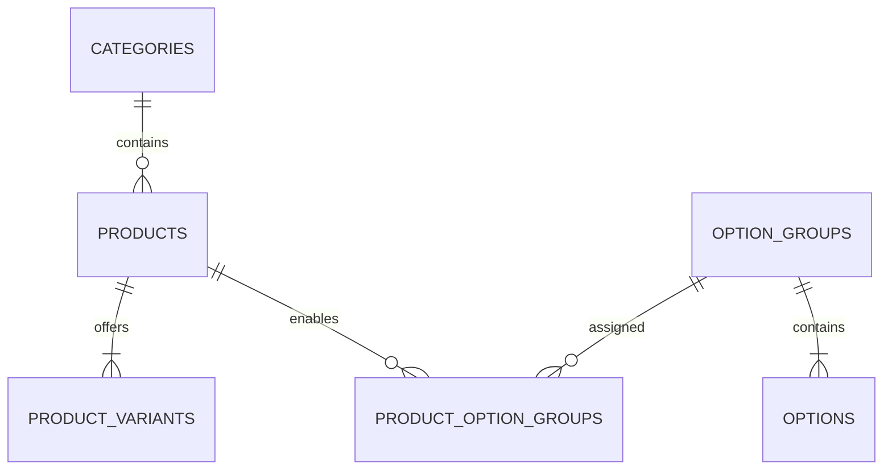
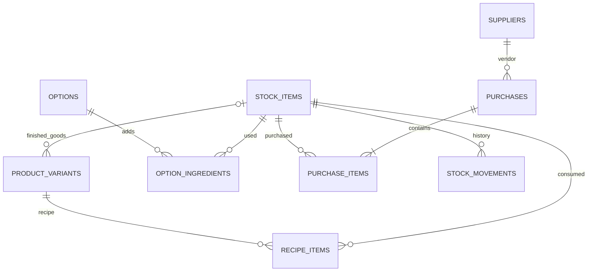
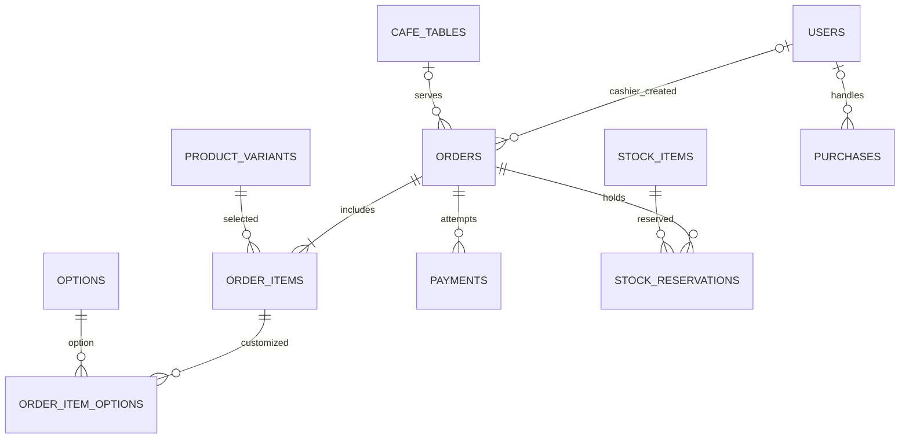

# DATABASE — Café POS V1

> **Status:** Rancangan untuk implementasi bertahap, belum tentu cocok dengan database yang saat ini ada.  
> **Database:** PostgreSQL. **20 tabel aplikasi** (tidak menghitung tabel bawaan Laravel untuk cache/session/jobs/migrations).  
> **Aturan bisnis:** `PRD.md`. Jangan buat semua migration sekaligus.

## 1. Prinsip data

1. `products` = menu untuk dijual; `stock_items` = barang fisik yang dihitung. Satu croissant dijual melalui variant `Regular` yang terkait 1 stok croissant `pcs`.
2. Varian coffee memakai `recipe_items`; opsi sugar menambahkan bahan lewat `option_ingredients`. **Tidak ada production batch pastry di V1**.
3. Semua channel memakai **satu** `orders`, `order_items`, `payments`, dan kitchen status.
4. Harga transaksi dan opsi disimpan sebagai **snapshot**. Jangan ubah riwayat ketika menu berubah.
5. `stock_items.on_hand_qty` adalah saldo yang dipelihara transaksi; setiap perubahan harus memiliki `stock_movements`.
6. Checkout membuat reservasi dulu. `available = on_hand - SUM(reservasi active)`; stok fisik dikurangi saat mulai `preparing`.
7. Satu `users` table untuk login pegawai; role tetap dalam kolom `role`, tanpa tabel permission terpisah.

## 2. ERD ringkas

### Menu (6 tabel)

### Inventory & purchasing (7 tabel)

### Orders, payments & staff (7 tabel)

`STOCK_ITEMS`, `PRODUCT_VARIANTS`, `OPTIONS` muncul di beberapa diagram karena ketiganya menghubungkan modul. Itu **tabel yang sama**, bukan duplikat.

## 3. Daftar tabel & kolom penting

Notasi: `PK` primary key, `FK` foreign key, `?` nullable, `UQ` unique. Semua tabel operasional menggunakan timestamps Laravel bila relevan.

### A. Menu

| Tabel                   | Kolom penting                                                                             | Kegunaan                              |
| ----------------------- | ----------------------------------------------------------------------------------------- | ------------------------------------- |
| `categories`            | `id` PK, `name` UQ, `is_active` bool                                                      | Coffee, Pastry, Non-Coffee            |
| `products`              | `id` PK, `category_id` FK, `name`, `description?`, `image_path?`, `is_active`             | Identitas produk, bukan harga         |
| `product_variants`      | `id` PK, `product_id` FK, `stock_item_id?` FK, `name`, `price_idr` bigint, `is_available` | Hot, Iced, Regular, dan harga         |
| `option_groups`         | `id` PK, `name` UQ, `selection_type` (`single`/`multiple`), `is_active`                   | Sugar Level, Extras                   |
| `options`               | `id` PK, `option_group_id` FK, `name`, `price_delta_idr` bigint, `is_active`              | Zero/Low/Medium/High                  |
| `product_option_groups` | `product_id` PK/FK, `option_group_id` PK/FK, `is_required` bool                           | Pilihan yang boleh dipakai per produk |

**Menu constraints:** unique `(product_id, name)` di variant dan `(option_group_id, name)` di options. Product punya ≥1 variant (divalidasi saat publikasi). Harga dan delta >= 0. Untuk pastry tanpa opsi, simpan variant `Regular` dan sembunyikan pemilih varian di UI. Menu diurutkan alfabetis; belum ada `display_order`.

### B. Inventory dan purchasing

| Tabel                | Kolom penting                                                                                                             | Kegunaan                                      |
| -------------------- | ------------------------------------------------------------------------------------------------------------------------- | --------------------------------------------- |
| `stock_items`        | `id` PK, `name` UQ, `base_unit` (`g`/`ml`/`pcs`), `on_hand_qty` numeric(12,3), `reorder_point` numeric(12,3), `is_active` | Saldo bahan atau pastry jadi                  |
| `recipe_items`       | `id` PK, `product_variant_id` FK, `stock_item_id` FK, `quantity` numeric(12,3)                                            | Bahan per satu variant coffee                 |
| `option_ingredients` | `id` PK, `option_id` FK, `stock_item_id` FK, `additional_qty` numeric(12,3)                                               | Tambahan syrup sesuai sugar level             |
| `stock_movements`    | `id` PK, `stock_item_id` FK, `quantity_delta` numeric(12,3), `reason`, `source_key` UQ, `actor_user_id?` FK, `created_at` | Riwayat tambah/kurang stok yang tidak diedit  |
| `suppliers`          | `id` PK, `name`, `contact?`, `is_active`                                                                                  | Vendor bahan/pastry                           |
| `purchases`          | `id` PK, `supplier_id` FK, `status`, `created_by_user_id` FK, `received_by_user_id?` FK, `received_at?`, `created_at`     | Header pembelian, `draft/received/cancelled`  |
| `purchase_items`     | `id` PK, `purchase_id` FK, `stock_item_id` FK, `quantity` numeric(12,3), `line_cost_idr` bigint                           | Jumlah dalam satuan dasar + total biaya baris |

**Inventory constraints:** `quantity > 0`, `additional_qty >= 0`, `on_hand_qty >= 0`, `line_cost_idr >= 0`. Unique `(product_variant_id, stock_item_id)` dan `(option_id, stock_item_id)` untuk resep; unique `(purchase_id, stock_item_id)` untuk pembelian sederhana V1.

**Pembelian:** Draft tidak menaikkan stok. Aksi `receive` hanya sekali: lock purchase, pastikan `status=draft`, lalu catat seluruh quantity dari purchase items sebagai movement positif dan ubah status `received` dalam satu DB transaction. Jika barang tidak lengkap, koreksi jumlah draft sebelum penerimaan; tidak ada partial receiving V1.

**Recipe:** Coffee variant: `stock_item_id = NULL`, memiliki recipe rows. Pastry variant: `stock_item_id` menunjuk stok finished `pcs`; tidak memakai recipe penjualan. Option ingredients hanya menambah qty dan tidak melakukan penggantian/substitusi bahan.

### C. Order, staff & payment

| Tabel                | Kolom penting                                                                                                                                                               | Kegunaan                                                            |
| -------------------- | --------------------------------------------------------------------------------------------------------------------------------------------------------------------------- | ------------------------------------------------------------------- |
| `users`              | `id` PK, `name`, `email` UQ, `password`, `role` (`owner/cashier/kitchen`), `is_active`                                                                                      | Akun pegawai + fixed role                                           |
| `cafe_tables`        | `id` PK, `label` UQ, `is_active`                                                                                                                                            | QR berisi URL menu dengan ID meja; tanpa token meja                  |
| `orders`             | `id` PK, `table_id?` FK, `created_by_user_id?` FK, `source`, `fulfillment_type`, `status`, `public_token` UQ, `checkout_key` UQ, `total_idr` bigint, `notes?`, `created_at` | QR/cashier masuk tabel yang sama                                    |
| `order_items`        | `id` PK, `order_id` FK, `product_variant_id` FK, `product_name_snapshot`, `variant_name_snapshot`, `unit_price_idr` bigint, `quantity` int                                  | Detail dengan harga beku                                            |
| `order_item_options` | `id` PK, `order_item_id` FK, `option_id` FK, `option_name_snapshot`, `price_delta_idr` bigint                                                                               | Opsi terpilih dengan snapshot                                       |
| `payments`           | `id` PK, `order_id` FK, `method` (`cash/qris`), `provider?`, `provider_reference?` UQ, `amount_idr` bigint, `status`, `paid_at?`, `created_at`                              | Satu order bisa punya beberapa attempt QRIS, satu pembayaran sukses |
| `stock_reservations` | `id` PK, `order_id` FK, `stock_item_id` FK, `quantity` numeric(12,3), `status` (`active/consumed/released`), `expires_at?`                                                  | Hold stok hasil agregasi kebutuhan order                            |

`orders.source`: `cashier` / `table_qr`. `fulfillment_type`: `dine_in` / `takeaway`. `orders.status`: `awaiting_payment`, `queued`, `preparing`, `ready`, `completed`, `cancelled`, `payment_review`. `payments.status`: `pending`, `paid`, `failed`, `expired`, `refunded`.

**Relationship rules:** QR table order => `table_id` wajib, `created_by_user_id=NULL`, dine-in. Cashier order => `created_by_user_id` wajib; dine-in perlu meja, takeaway tanpa meja. Unique `(order_id, stock_item_id)` pada stock reservations (hasil agregasi, bukan per line). `checkout_key` mencegah duplicate order akibat retry client. `public_token` disediakan untuk status customer privat; ID meja pada URL bukan izin akses ke pesanan.

**Meja & QR — irisan awal:** hanya UI admin untuk mengelola label serta status aktif meja dan mengekspor QR; link QR memakai `/menu?table={id}`. UI pelanggan ditunda untuk dikerjakan pengguna secara terpisah. Tujuan QR sementara hanya memberikan teks belum tersedia, tanpa katalog publik, order, payment, reservasi, atau movement. Migration `create_cafe_tables_table` membuat tabel langsung tanpa `qr_token`, sebelum migration order yang mereferensikannya; rollback menghapus tabel order terlebih dahulu, lalu meja. Riwayat migration lokal dirapikan dan database development direset atas persetujuan pengguna; tidak ada migration penghapusan token terpisah. Guest checkout dan QRIS masih tahap berikutnya; ide akses guest berbasis session, receipt, dan akun customer tetap dicatat di `note`.

## 4. Transaksi dan integritas (penting)

| Event                 | Harus atomik / idempotent                                                                                                                                                  |
| --------------------- | -------------------------------------------------------------------------------------------------------------------------------------------------------------------------- |
| **Checkout**          | Lock stock items, kalkulasi harga di server, validasi available, simpan order + snapshot + reservasi. Ulang request dengan checkout key sama menghasilkan order yang sama. |
| **Cash confirmed**    | Simpan paid cash payment + tandai order `queued` sekali. Cashier tidak dapat membuat paid order via URL guest.                                                             |
| **QRIS callback**     | Verifikasi signature, reference, amount, currency; lock order/payment; callback duplikat tidak membuat paid/queued kedua kali.                                             |
| **Expiry**            | Payment/order unpaid expired => release hold; jika provider ternyata sudah menerima uang setelah release, `payment_review`, jangan langsung masuk kitchen.                 |
| **Kitchen preparing** | Lock order & stock; update `queued -> preparing`; kurangi `on_hand_qty`, tulis stock movements dengan source key unik, tandai reservations consumed, sekali saja.          |
| **Purchase receive**  | Lock purchase + stock; tambah saldo dan movement; ubah ke received dalam transaksi yang sama; request kedua ditolak/dianggap sudah processed.                              |
| **Stock adjust**      | Perlu alasan; update saldo dan movement beserta aktor dalam satu transaksi.                                                                                                |

**Saldo:** semua perubahan `on_hand_qty` hanya melalui satu jalur service/DB transaction. Saat hitung stok tersedia, lock baris `stock_items` dalam urutan ID konsisten. Hold aktif order **berbayar** tidak di-expire otomatis hanya karena kitchen lambat (`expires_at = NULL` setelah paid). Setelah cancellation sebelum preparing, release. Setelah preparing, jangan restore otomatis.

**Indexes minimum:** `orders(status,created_at)`, `orders(table_id,created_at)`, `payments(order_id,status)`, `order_items(order_id)`, `stock_reservations(stock_item_id,status)`, `stock_movements(stock_item_id,created_at)`, `purchases(status,created_at)`. `provider_reference` unique ketika tidak null; pastikan satu payment paid per order lewat validasi transaksional dan/atau partial unique index PostgreSQL.

**Referential integrity:** jangan hard-delete product, option, supplier, user, atau stock item yang sudah punya histori. Nonaktifkan. FK boleh nullable pada actor lama bila benar-benar diperlukan, tetapi riwayat operasional tetap terjaga.

## 5. Urutan migration (bukan sekaligus)

1. **Menu:** 6 tabel menu, awalnya `product_variants` tanpa `stock_item_id` FK.
2. **Inventory:** tambah 4 tabel stok & resep; tambah nullable `product_variants.stock_item_id` FK.
3. **Auth:** gunakan `users` Laravel dan tambahan `role/is_active` (sebelum pembelian).
4. **Purchasing:** 3 tabel pembelian, supplier, line.
5. **POS:** 6 tabel transaksi/pembayaran/reservasi termasuk `cafe_tables`.
6. **Kitchen/QR:** gunakan tabel transaksi yang sudah ada; perlu logic baru, **bukan** sistem order duplikat.

Tidak semua field di sini harus dimasukkan sejak hari pertama. Tambahkan field ketika fitur terkait dikerjakan; pertahankan constraint dan transaksi kritis.

## 6. Tidak perlu dibuat di V1

`production_batches`, `goods_receipts`, `roles`, `permissions`, `role_permissions`, `customers`, `table_sessions`, `deliveries`, `warehouses`, `invoices`, `audit_logs` generik. Riwayat stok/pembelian/pembayaran + actor fields adalah audit operasional minimal V1. Jika kemudian perlu audit konfigurasi/role yang lebih lengkap, desain fitur itu secara eksplisit pada versi berikutnya.
